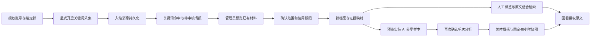

# 苍南 OSINT 工作空间 — 技术文档

更新日期：2026-11-02。本文替代早期自动对话原型说明，面向授权材料管理、群档案检索与有证据的分析。

> 版本范围：本文根据当前工作区源码及此前部署验收编写，本次只提交文档。部分已部署功能源码、迁移和测试尚未纳入 Git；克隆本提交不等于取得完整部署版本，运行命令前须确认文件和依赖齐备。验收记录不是持续在线保证，也不是本次重新执行测试的声明。

## 1. 系统定位与架构

系统将平台账号、授权采集、已有消息、情报审核、群档案和 AI 分析连接起来。当前群档案来源主要是 Telegram 指定群的已有关键词命中材料，不是全网搜索，也不是完整群聊历史镜像。

| 层次 | 技术与职责 |
|---|---|
| 浏览器 | Next.js 14、React、TypeScript、Tailwind CSS；角色导航、表单、证据回看 |
| 接口 | FastAPI、Pydantic；认证、授权、版本校验与只读查询 |
| 持久化 | PostgreSQL、SQLAlchemy、Alembic；消息、来源、档案、任务和快照 |
| 异步分析 | Redis、Celery；独立 `osint_analysis` 队列，结果保存在数据库 |
| 平台接入 | Telegram 使用 Telethon；Facebook 使用 Playwright；Zalo 仍有未验证边界 |
| 模型 | DeepSeek 兼容接口；仅在明确授权后发送有限材料，不授予任意平台操作工具 |
| 部署 | Nginx TLS 反代、systemd、回环监听；Compose 仅作为开发/联调配置 |

保留 FastAPI + Celery 架构。平台连接、网页通知连接、Session 存在、身份有效和新消息入库是不同状态，不能互相代替。

## 2. 主要业务链路

- **采集与归档**：只处理明确开启后收到的新消息；命中记录与情报记录保留关联，不默认回补历史或私信成员。
- **群档案**：管理员选择候选任务、时间范围和 1–30 天使用期；预览不等于纳入，选择来源不等于同意。
- **人工标注**：标签、备注与来源版本关联；AI 快照不会覆盖人工标签。
- **网络目录**：有限层级的群组/频道候选目录，与消息情报、群档案分开；开发或部署不代表授权真实加入。
- **账号培育**：定位、每日计划、内容草稿和手动进度，不自动改 TG 资料、发帖、私信或入群。
- **私聊自动回复**：独立、默认关闭的 TG 白名单功能；开启会产生消息外发和模型费用，不属于只读分析。

## 3. 群档案组合检索

入口为 `/intelligence/groups`。管理员可按原文主题、提及地区、时间和已保存的发送方平台 ID 查找材料。

| 规则 | 实际语义 |
|---|---|
| 主题、地区 | 英文逗号、中文逗号或顿号分隔；NFKC 归一化及不区分大小写的字面子串匹配 |
| 组合 | 同栏任一词命中，跨栏全部满足；所有条件必须由同一条有效原文满足 |
| 时间 | 开始包含、结束不包含，可单边限制；接口使用含秒和时区的 ISO 时间，最多微秒精度 |
| 发送方 | 精确数字串，可带负号；不接受姓名或 `@用户名`，不实时查询平台补全 |
| 原话回看 | 仅回看该 ID 在本群、当前授权材料内的记录；保留已提交时间范围，清除主题/地区条件 |
| 旧关键字 `q` | 筛群列表的标签、标题、备注或有效原文；不直接过滤原文列表 |
| 查询副作用 | 群档案 GET 查询不写库、不调用 AI、不连接 Telegram |

例如“主题：物流；地区：东北”只表示同一条原文出现两个词，不证明发言者身处东北或群成员来自东北；不会自动将“东北”扩展成三省，也不是自然语言语义检索。

响应包含 `matched_message_count`、`search_matches`、`sender_id`、`sender_status` 和证据到期时间。发送方必须在消息与情报来源中一致；缺失或冲突不展示可归因 ID。文本或时间版本冲突的消息排除出组合检索；仅发送方冲突时，文本仍可用于不带发送方条件的检索。

## 4. 单次 AI 群组分析

群分析与普通用户 AI 对话分析是两条独立业务链路，共用专用 worker，不共用权限范围或取样预算。

1. 管理员预览实际待分享文本、脱敏/截短情况、覆盖数量、模型和固定截止时刻 `as_of`；预览不调用外部 AI。
2. 明确确认后创建单次任务，冻结来源依赖、模型绑定、提示版本与操作号。
3. `osint.group_analysis` 执行前和结果保存前复核授权及材料，失败或失效不冒充成功。
4. 保存 `overall` 总体概括与 `recent` 近 48 小时快照；近期窗口为 `[as_of - 48h, as_of)`，不是“库中最后两天”。窗口没有样本时明确无近期材料。
5. 结论区分“明确提及 / 推断 / 依据不足”，引用必须来自本次对应部分的有效样本；点击引用时再次校验证据。

每部分最多 40 条、16,000 字符，单条最多 1,200 字符；属于有限样本，脱敏不保证清除所有个人信息。一次确认不授权持续分析，页面刷新不触发重新调用；取消不能撤回已经发送给模型的内容或费用。

任务状态包括 `queued`、`running`、`succeeded`、`failed`、`cancelled`、`result_unknown`。调用结果不确定时不自动重发；每群同时仅允许一个排队、运行或结果未知任务。

## 5. 数据模型与迁移

| 层级 | 表 | 作用 |
|---|---|---|
| 来源事实 | `messages`、`conversations`、`intelligence_records` | 原始消息及情报关联 |
| 采集关联 | `group_monitors`、`group_keyword_hits` | 采集范围、关键词命中 |
| 群档案 | `group_dossiers` | 平台与群 ID 唯一；人工标签、备注及版本 |
| 材料授权 | `group_dossier_sources` | 来源账号、采集任务、创建人、时间段、使用期限和撤销状态 |
| 证据映射 | `group_dossier_evidence` | 关联命中与消息，保存内容摘要供完整性校验 |
| 单次群分析 | `group_analysis_jobs` | 冻结输入依赖、派发标识、状态和期限 |
| 分析快照 | `group_analysis_snapshots` | 总体/近期结果、覆盖范围、引用和模型版本 |

工作区迁移链为 `001 → 002 → 003 → 004 → 005 → 006 → 007 → 008 → 009`。最近部署从 `007` 增量升级到 `009`，`008` 新增三张档案表，`009` 新增两张分析表；组合检索不再新增表。

来源撤销、到期、身份/权限或材料变化后，不再作为本模块有效检索、标注或分析依据。隐藏和失效不等于删除原始消息，也不能撤回先前已发送给模型的材料。

## 6. 群档案 API

以下路径统一加 `/api/v1/group-intelligence` 前缀，全部要求管理员身份；账号级普通用户授权不授予全局群档案访问权。

| 方法 | 相对路径 | 用途 |
|---|---|---|
| GET | `/candidates` | 分页读取可纳入的候选来源 |
| POST | `/source-preview` | 预览已有材料，不纳入、不调用 AI |
| POST | `/sources` | 明确确认后纳入，携带预览令牌和 `operation_id` |
| GET | `/operations/{operation_id}` | 查询材料/标注操作回执 |
| GET | `/groups` | 群列表；支持 `q`、`page` 及组合条件 |
| GET | `/groups/{group_id}` | 档案、来源和可见标注历史 |
| GET | `/groups/{group_id}/messages` | 授权原文；支持 `page` 及组合条件，不使用 `q` |
| PATCH | `/groups/{group_id}/annotations` | 保存人工标签/备注，携带 `revision` 与操作号 |
| POST | `/sources/{source_id}/revoke` | 明确确认撤销，校验来源版本 |
| POST | `/groups/{group_id}/analysis-preview` | 预览单次 AI 输入，校验档案版本 |
| POST | `/groups/{group_id}/analysis-jobs` | 确认创建群分析任务 |
| GET | `/groups/{group_id}/analysis-jobs` | 分页读取该群分析任务 |
| GET | `/analysis-jobs/{job_id}` | 读取单次任务状态 |
| POST | `/analysis-jobs/{job_id}/cancel` | 确认取消任务 |
| GET | `/groups/{group_id}/snapshots` | 分页读取可用状态及分析快照 |
| GET | `/snapshots/{snapshot_id}/evidence/{evidence_id}` | 校验快照后回看已引用原文 |

组合参数为 `topic`、`region`、`start_at`、`end_at`、`sender_id`。分页固定每页 20 条；每栏原始词项总长不超过 200 字符、归一化后每项最多 64 字符、最多 10 个去重词项。前端会先按非空原始词项计数，可能更早拒绝重复输入。

非法参数返回 422；身份/权限问题返回 401/403；版本变化或冲突通常返回 409；引用已到期可返回 410。写入超时不等于失败，应保留原操作号先读取回执，不自动重试写入。

## 7. 安全与运行边界

- JWT Cookie 使用 HttpOnly、SameSite=Strict，HTTPS 下使用 Secure；后端持续核验用户状态与 `token_version`。
- `OSINT_AUTH_SECRET` 同时影响会话及 AI Key 加密，不能为排障随意重生成；API 与 worker 必须一致。
- `.env`、管理员配置、Session/Cookie、AI Key、数据库备份、登录会话和业务原文不得进入 Git 或 Web 静态目录；远程仓库地址不得嵌入访问令牌。
- 平台接入使用账号/Session 文件锁；占用时查明进程，不删除锁文件或原 Session。
- Nginx 对外提供 TLS，API、前端、数据库、Redis 和代理仅按部署配置监听内部地址；不绕过 SSH 主机指纹或 TLS 验证。
- 重启 API 可能连带停止监听，启动 API 不保证自动恢复监听；发布时记录已运行名单，获授权后仅恢复原范围。
- `app.workers.tasks` 属于旧主动任务链路，不是只读分析 worker；不为测试页面而启动它。

## 8. 验收范围与交付限制

| 证据层级 | 最近已完成 | 不应推导出的结论 |
|---|---|---|
| 本地离线 | 1,843 项测试及 5 个子测试通过，隔离防护无意外事件 | 不能代替 PostgreSQL 并发或真实平台验收 |
| 本地浏览器 | 群档案 12 组、群分析 14 组通过；使用合成数据和模拟 AI | 不表示真实模型质量、费用或网络已经验证 |
| 前端构建 | TypeScript 和 Next.js 生产构建通过 | 不单独构成页面功能验收 |
| 最近生产部署 | `007 → 009`；停服务窗口中 20 张原有业务表数量与内容摘要不变 | 不代表以后任意时刻数据不变 |
| 生产浏览器 | 8 项检查通过：认证边界、真实候选、空档案、组合 GET、错误恢复、响应式和指南 | 未确认纳入真实材料、未调用真实 AI，也未重新提交原管理员密码测试登录 |
| 备份 | 数据库、应用、配置、Session 与旧构建已私密备份；数据库归档完整解码检查通过 | 尚未完成独立数据库恢复演练 |

最近生产验收没有导入合成样例、自动建档或执行旧主动任务。群档案初始为空是正确状态；应由管理员自行预览并明确确认已有材料后试用。

后续重点：获授权的最小真实材料分析与人工核验、独立备份恢复演练、容量/并发评估，以及 Facebook/Zalo 分别验收。尚不提供语义向量检索、自动地域推断、跨平台真人画像或持续 AI 监控。

完整架构、源码位置、检索限制、隔离测试入口与发布清单见 [技术路线与框架](技术路线与框架.md)。
