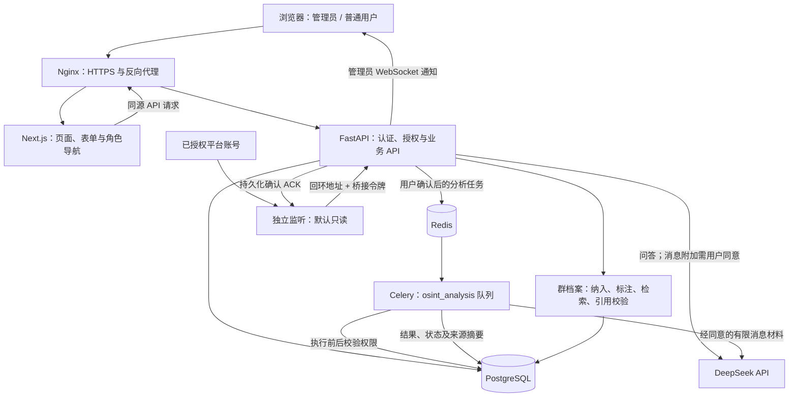

# 苍南：技术路线与框架

更新日期：2026-11-02。本文依据当前工作区源码及此前部署验收编写；运行状态为验收快照，不代表后续持续可用，本次文档更新没有重跑生产业务。

> 本次仅提交文档。部分已部署功能源码、迁移和测试仍未纳入 Git；下文路径描述工作区实现位置，不保证本次 Git 提交包含对应文件。取得完整、经过核验的源码版本后才能按本文复现，不应将旧仓库代码直接部署覆盖现网。

## 1. 项目定位

苍南是面向授权业务的社交情报工作空间，将平台账号、已入库消息、用户权限、群档案和 AI 分析连接起来。

两条主要流程彼此隔离：

- **普通用户分析**：管理员分配账号级数据来源 → 用户与 AI 商议目标 → 明确确认消息分享与任务 → 后台只读分析 → 查看结果。
- **管理员群档案**：授权指定群关键词采集 → 消息与命中情报归档 → 预览并确认已有材料 → 人工标签 → 地区、主题、时间组合检索 → 回看原话；另行确认后生成总体概括与固定近 48 小时快照。

系统不将“页面能打开”“Session 文件存在”“账号登录有效”“监听正在运行”“收到新的消息”视为同一件事，也不以模拟数据代替实际业务结果。群档案只代表获准使用的有限材料，不代表完整群历史、群成员真实所在地或真人身份。

## 2. 总体技术路线

采用 **Next.js 前端 + FastAPI 模块化后端 + PostgreSQL 持久化 + Redis/Celery 异步任务 + 独立平台监听进程**，保留现有 Python 服务架构，不引入新的微服务平台或通用自主执行 Agent。

| 路线 | 当前做法 | 选择原因与边界 |
|---|---|---|
| 前后端分离 | Next.js 展示交互，FastAPI 提供业务接口 | 页面与业务逻辑分工清晰，后端统一做权限校验 |
| 关系型数据持久化 | PostgreSQL + SQLAlchemy + Alembic | 保留账号、授权、消息、任务之间的稳定关联 |
| 长任务异步化 | Redis 作为消息代理，Celery 独立执行分析 | 避免 AI 分析阻塞 HTTP 请求；任务结果写入数据库 |
| 平台接入适配 | Telegram、Facebook、Zalo 各自独立适配器 | 不同平台登录机制不同，不能用统一布尔值掩盖验证差异 |
| 实时消息通道 | 独立监听进程通过内部 WebSocket 桥接 API | 平台连接与网页连接分离，数据库确认后再通知页面 |
| AI 能力约束 | DeepSeek 输出答复及结构化分析提案 | 模型不获得任意命令、任意平台操作或无限制工具调用权限 |
| 渐进交付 | 本机验证、隔离构建、备份、增量迁移、服务切换 | 避免覆盖生产配置、会话与业务数据库 |

## 3. 分层架构



图中的平台接入表示代码架构，不代表三个平台的生产链路均已验证可用。TG 白名单被动自动回复必须单独开启，会向模型分享材料并向平台发送消息，不属于默认只读路径。

### 各层职责

- **展示层**：品牌、登录注册、管理员工作台、账号管理、用户授权、AI 配置与任务对话。
- **接口层**：参数校验、登录身份、角色隔离、来源权限、业务查询和任务确认。
- **服务层**：平台身份检测、消息证据整理、AI 请求、任务调度和状态更新。
- **执行层**：只读 Celery 分析任务与用户手动启动的账号监听进程。
- **存储层**：数据库保存业务事实；平台 Session/Cookie 保存于受保护的运行目录。
- **运维层**：Nginx、systemd、数据库迁移、备份、证书续期和运行健康检查。

## 4. 技术栈与框架

下表区分“依赖声明”与“部署版本”。后端使用最低版本约束，并非完整锁定文件；不能把最低版本当作实际安装版本。

| 层次 | 技术 | 当前依据 |
|---|---|---|
| 前端框架 | Next.js 14、React 18 | `frontend/package.json`；本次生产构建使用 Next.js 14.2.35 |
| 前端语言 | TypeScript | `frontend/tsconfig.json`；依赖声明 `^5.5.0` |
| 样式 | Tailwind CSS 3、PostCSS、全局 CSS | `frontend/tailwind.config.js`、`frontend/src/app/globals.css` |
| 后端语言 | Python ≥ 3.12 | `backend/pyproject.toml` |
| Web API | FastAPI ≥ 0.115、Uvicorn ≥ 0.34 | 异步 HTTP 与 WebSocket 服务 |
| 数据校验 | Pydantic 2、pydantic-settings | 请求模型、配置读取与结构化 AI 答复校验 |
| ORM 与迁移 | SQLAlchemy 2、Alembic | 异步业务会话，独立增量迁移 |
| 数据库驱动 | asyncpg、psycopg2-binary | 分别支持异步访问和同步迁移等场景 |
| 数据库 | PostgreSQL | Compose 开发配置使用 PostgreSQL 16 镜像，不等同生产安装版本 |
| 消息代理 | Redis | Compose 使用 Redis 7；生产实际版本须另行核验，不能从开发镜像推断 |
| 异步任务 | Celery ≥ 5.4 | 独立 `osint_analysis` 队列 |
| AI 客户端 | OpenAI Python SDK + DeepSeek 兼容接口 | `workspace_ai.py`；支持 `deepseek-chat`、`deepseek-reasoner` |
| Telegram | Telethon | Session 登录、真实身份查询、入站消息监听 |
| Facebook | Playwright | 浏览器登录、Cookie 与登录状态检查；属于可选依赖 |
| Zalo | zlapi（可选依赖声明） | 当前未实例化未经验证的 SDK 客户端；只读身份接口未核实，状态返回未知 |
| 身份与加密 | python-jose、PBKDF2、cryptography/Fernet | JWT 会话、密码哈希、管理员 AI Key 加密 |
| 验证 | pytest、pytest-asyncio、隔离 SQLite、Playwright | 后端回归及实际浏览器检查 |
| 生产入口 | Nginx + systemd | TLS、反向代理、进程管理与开机启动 |

## 5. 主要模块与代码位置

以下路径均相对于应用仓库根目录。

| 模块 | 主要文件 | 职责 |
|---|---|---|
| 应用外壳 | `frontend/src/app/layout.tsx`、`workspace-shell.tsx` | 页面标题、品牌、角色导航、会话校验、通知通道 |
| 登录与注册 | `frontend/src/app/login/page.tsx`、`register/page.tsx` | 共用登录入口、普通用户注册 |
| 账号工作区 | `frontend/src/app/accounts/page.tsx` | 平台状态、姓名、备注、重新登录及监听操作 |
| 管理员功能 | `frontend/src/app/admin/users/page.tsx`、`admin/ai/page.tsx` | 普通用户管理、来源授权、AI 配置 |
| AI 用户工作区 | `frontend/src/app/assistant/page.tsx` | 任务对话、数据分享同意、确认与结果展示 |
| 前端请求封装 | `frontend/src/lib/api.ts` | REST API、错误处理、超时和 WebSocket 客户端 |
| API 入口 | `backend/app/main.py` | 生命周期、路由、认证中间件、消息持久化与 WebSocket |
| 认证 | `backend/app/core/auth.py` | 用户校验、管理员初始化、注册、登录和退出 |
| 管理员 API | `backend/app/api/users.py` | 用户信息、状态及来源授权 |
| 业务 API | `backend/app/api/routes.py` | 账号、历史业务数据、会话检测、登录及监听管理 |
| AI API | `backend/app/api/assistant.py` | 对话、分析提案、确认、任务状态及管理员 AI 配置 |
| AI 服务 | `backend/app/services/workspace_ai.py` | Key 加密、模型调用、脱敏和结构化答复校验 |
| 分析服务 | `backend/app/services/workspace_tasks.py` | 普通用户来源权限、有限消息材料、排队与结果写回 |
| 只读 worker | `backend/app/workers/assistant.py` | 注册 `osint.analysis` 和 `osint.group_analysis`，消费独立队列 |
| 平台适配 | `backend/app/services/platform/` | 各平台具体连接、登录和状态实现 |
| TG 身份 | `backend/app/services/telegram_identity.py` | 真实姓名、固定 TG ID、有效期及身份冲突保护 |
| 独立监听 | `backend/listen_account.py` | 账号锁、会话锁、平台连接、内部桥接与 ACK；默认只读 |
| 白名单回复 | `backend/app/services/telegram_replies.py` | 单账号授权对象、回复风格及发送前校验；必须明确开启 |
| 指定群采集 | `backend/app/api/group_monitors.py`、`backend/app/services/group_monitoring.py` | 指定账号/群/关键词采集与命中归档 |
| 情报网络目录 | `backend/app/api/telegram_network.py`、`backend/app/services/telegram_network.py` | 有限层级候选目录与独立确认的执行范围 |
| 账号培育 | `backend/app/api/account_cultivation.py`、`backend/app/services/account_cultivation.py` | 定位、计划、草稿与手动进度，不自动操作平台 |
| 群档案 API | `backend/app/api/group_intelligence.py` | 候选、预览、纳入、撤销、标注、组合查询和回执 |
| 群档案服务 | `backend/app/services/group_intelligence.py` | 来源有效性、去重、版本冲突、发送方归因及只读筛选 |
| 群分析 API/服务 | `backend/app/api/group_analysis.py`、`backend/app/services/group_analysis.py` | 固定样本、单次确认、快照和引用校验 |
| 群档案页面 | `frontend/src/app/intelligence/groups/page.tsx`、同目录 `analysis-panel.tsx` | 材料确认、检索、原话回看及独立分析操作 |
| 类型与响应校验 | `frontend/src/lib/group-intelligence.ts`、`group-analysis.ts` | 参数归一化、微秒时间比较和严格响应解码 |
| 使用指南 | `frontend/src/app/help/page.tsx` | 已部署页面内的操作说明和能力限制 |
| 数据模型 | `backend/app/models/models.py` | 业务实体、用户、来源授权、群档案与分析快照 |
| 数据迁移 | `backend/alembic/versions/` | 按版本管理数据库结构，工作区当前到 `009` |

仓库还保留 `app/workers/tasks.py`、对话引擎、情报处理模块和早期脚本，其中包含主动平台操作能力。它们与当前只读分析链路不同，不能因为源码存在就认为已安全启用或完成生产验收。

## 6. 核心业务链路

### 6.1 登录、注册与来源授权

1. 普通用户通过用户名、显示名称和密码注册，不依赖短信；后端固定创建 `user` 角色。
2. 管理员从受保护的部署配置初始化，程序不会覆盖已有用户或将同名普通用户自动提升为管理员。
3. 登录成功签发约 8 小时有效的 JWT Cookie；使用 HttpOnly、SameSite=Strict，在 HTTPS 下使用 Secure。
4. 后端核验用户是否启用、是否删除及 `token_version`，不只信任前端导航或 JWT 中的身份信息。
5. 管理员通过 `account_grants` 为用户分配平台账号对应的数据来源；未授权来源不可分析。
6. 普通用户仅可访问自己的 AI 工作区相关接口，不可访问全局账号、历史管理页面或管理员 WebSocket。
7. 退出登录递增用户的 token 版本，使此前会话失效。

密码使用 PBKDF2-HMAC-SHA256、随机盐和 600,000 次迭代。公开注册与“未登录即可读取业务数据”是两回事。

### 6.2 Telegram 身份与重新登录

1. 数据库账号 UUID、Session 名称及经验证的 Telegram 用户 ID 共同维持原账号关联。
2. 后台通过真实 `get_me` 查询校验身份；姓名来自 Telegram 的 first_name / last_name，备注单独显示。
3. 未监听账号通常按约 60 秒间隔检查，Session 证明有效期为 90 秒；监听侧有独立的连接证明，有效期为 45 秒。
4. 页面定时同步状态并处理证明过期；网络异常、过期和身份不匹配不能显示为确定可用。
5. “重新登录”复用手机号、验证码和两步验证流程，固定原 Session 名称，不要求先删除账号。
6. 已有 TG ID 时必须核验同一身份；没有历史 TG ID 时属于首次绑定，不能宣称已证明是原账号。
7. 登录、检测与监听通过账号及 Session 文件锁互斥；监听未停止时不能直接进行重登发码。

**已知边界**：退出重登弹窗不会立即取消服务端的待验证状态；被撤销的 Session 恢复能力仍需真实验证。重新登录成功不自动启动监听，也不保证平台对外“在线”状态。

### 6.3 入站消息与实时通知

1. 管理员手动启动指定账号的只读监听。
2. 监听进程连接平台并验证身份，然后接收入站消息。
3. 通过回环地址和专用桥接令牌向 FastAPI 发送消息事件。
4. API 校验账号和消息字段，以稳定的消息标识生成 UUID5，避免重复写入。
5. 消息写入 `conversations` / `messages` 后向监听进程发送持久化 ACK。
6. API 向已认证管理员的 WebSocket 推送新消息通知。

监听存在有界内存缓冲与丢弃事件计数，不能承诺进程崩溃时绝不丢消息。浏览器“通知通道已连接”只代表浏览器与 API 已连接，不代表平台已连接或正在采集。

### 6.4 AI 问答与只读分析任务

1. 用户选择已授权来源并创建自己的 AI 对话。
2. 问答内容会发送给 DeepSeek；附加来源消息另需用户明确同意，默认不分享。
3. 模型返回自然语言答复和可选的结构化提案，由 Pydantic 验证格式，不直接执行任务。
4. 用户确认提案及消息分享后，API 创建分析任务并检查 Redis、worker 和目标队列可用性。
5. 消息材料最多取最近 100 条，单条最多 2,000 字符，总内容预算约 24,000 字符；不是全库无限制发送。
6. worker 执行前复核用户及来源权限，调用 DeepSeek 分析已入库消息，不连接平台执行发信或入群。
7. 结果写回前再次复核权限及本轮 `dispatch_id`，避免已取消、重试或过期任务的旧结果覆盖当前状态。
8. 结果保存于 PostgreSQL；界面读取状态及结果，展示消息数量、最新时间和来源摘要。

无消息时明确返回“没有可分析的已入库消息”。模型被要求区分事实、推断和未知并标注消息 ID，但引用准确性仍需人工复核；现有正则脱敏也不是完整的数据泄露防护系统。

### 6.5 指定群采集与群档案纳入

1. 管理员选择有权使用的账号及群组，明确确认加入和关键词采集范围；采集只处理开启后收到的新消息，不回补全量历史，也不自动私信成员。
2. 消息入库后，关键词命中关联 `group_monitors`、`group_keyword_hits` 与 `intelligence_records`；开启配置与监听真实在线分开显示。
3. 群档案页读取已有候选；没有合格命中材料时保持真实空状态，不拿普通私聊或任意旧消息补齐。
4. 管理员选择来源、时间范围和 1–30 天材料使用期，先预览再确认纳入；一次最多 500 条，一个群最多 5,000 条证据映射。
5. 纳入保存来源及证据映射，不复制整段历史作为永久授权；群以 `(platform, peer_id)` 唯一标识。
6. 每次读取复核账号、平台身份、采集任务、消息/命中/情报关联、内容摘要、审核状态、来源创建者权限、撤销和到期状态。
7. 来源不再有效时，原文及依赖它的标签、备注、历史和分析结论按依赖关系隐藏或排除；不删除原始业务消息。

本模块当前仅管理员可访问，普通用户已有账号级来源授权不等于取得全局群档案权限。GET 读取不连接平台、不派发任务、不调用 AI。

### 6.6 地区、主题、时间与账号原话检索

群列表和原文列表共用 `EvidenceFilters`。接口完整表见 [技术文档](TECHNICAL_DOC.md#6-群档案-api)。

| 参数 | 契约 |
|---|---|
| `topic`、`region` | 英文逗号、中文逗号、顿号分隔；NFKC + casefold；按原文字面子串匹配 |
| 词项限制 | 每栏原始输入最多 200 字符，归一化后每项最多 64 字符，最多 10 个去重词项；前端先按非空原始词项计数，可能更早拒绝重复项 |
| `start_at`、`end_at` | ISO 时间必须带秒和时区，小数最多 6 位；转 UTC 后按微秒比较，开始包含、结束不包含，可单边限制 |
| `sender_id` | 满足 `-?[1-9][0-9]{0,19}` 的精确数字串；不接受 `@用户名`、姓名、零开头或实时平台身份补全 |
| `q` | 仅群列表支持，最多 100 字符；匹配有效标签、标题、备注或原文，不过滤原文列表 |
| `page` | 从 1 开始，固定每页 20 条 |

同一栏的词项为 OR，不同条件之间为 AND，而且必须由**同一条有效原文**满足。标签或群名不能代替地区原文依据，不跨消息拼接；“东北”只表示文本提及，不推断所在地，也不自动扩展为省份词表。

去重键为 `(Telegram, peer_id, 归一化的 external_id)`。同一消息存在文本或时间版本冲突时，不进入组合检索。无组合条件的旧 `q` 仍可查有效来源的各原文版本，但不能把冲突记录当作可靠归因；启用组合条件后，`q` 的原文匹配仅在已过滤消息内进行。

发送方仅在消息元数据、情报来源及非空 `target_user_id` 一致时展示，状态为 `recorded`；缺失为 `unavailable`，不一致为 `conflict`，后两者隐藏 ID。仅发送方冲突不妨碍无发送方条件的文本匹配，不能由此归因到账号。

群列表返回 `matched_message_count` 和 `evidence_expires_at`，原文返回主题/地区 `search_matches`。点击“查看该账号本群原话”使用已保存 ID，清除本区主题/地区并保留已提交时间范围，只查询本群有效授权材料，不做跨群或跨平台身份拼接。

当前采用有界扫描和服务层核验，不是全文/向量搜索引擎。群目录上限 2,000、全局来源上限 10,000、全局证据映射上限 50,000；超限返回明确错误而非静默截断。分页只控制结果输出，不代表无需扫描；扩容须另做性能和授权一致性评估。

### 6.7 单次 AI 总体概括与固定近 48 小时快照

1. 管理员预览固定 `as_of`、实际待分享文本、覆盖统计、截短/脱敏说明及模型；预览令牌有效期 10 分钟，不调用外部 AI。
2. 总体部分只使用截止时刻前的有效授权材料，近期部分固定为 `[as_of - 48h, as_of)`；不能用历史数据的最后两天代替“近两天”。
3. 每部分按时间分层确定性取样，最多 40 条、16,000 字符，单条最多 1,200 字符；展示未取样、截短及冲突数量。它与普通用户分析的 100 条预算不同。
4. 管理员再次明确确认，任务绑定操作号、来源依赖、身份/配置摘要、提示版本与 `dispatch_id`，交由 `osint.group_analysis` 单次执行。
5. 发送前与写结果前再次检查授权、时间和材料；模型输入视为不可信数据，不接受原文中的指令，不给予浏览器、命令或平台操作工具。
6. 结构化结论区分明确提及、推断、依据不足；引用必须属于该部分的实际样本，未知引用被拒绝。总体无材料不建任务，近期无材料明确表示无样本。
7. 保存 `overall` / `recent` 两类独立快照，不覆盖人工标签。快照读取及点击引用时重新校验来源、原文摘要、有效期及创建者权限。

状态为 `queued / running / succeeded / failed / cancelled / result_unknown`。每群同时只允许一个排队、执行或结果未知任务。超时/发送结果不确定不自动重发；取消不能撤销已经交给模型的文本或费用。刷新只是读历史快照，不持续重算，不自动分析新消息；真实模型质量仍需最小授权样本和人工核验。

### 6.8 前端一致性与失败处理

- 搜索草稿与已提交条件分离；刷新、分页和选群使用已提交条件，新搜索清除旧选择和证据，清除搜索重置表单。
- 异步读取使用 AbortController 和请求序号，避免慢响应覆盖新结果；材料操作和分析面板互锁，避免相互改变确认前提。
- 网络错误、响应结构异常、权限失效或证据到期时，不继续展示旧原文、发送方和命中数；相关分析结果也按有效性隐藏。
- 纳入、标注、创建分析等写入保留稳定操作号。回执未知时先以 GET 核对，不自动换操作号重发；读取成功不等于授权再次执行。
- 原文按文本展示，不解释其中的 HTML；桌面与手机均需检查表单、错误状态、引用内容及横向溢出。

## 7. 数据模型与迁移策略

| 数据组 | 主要表 | 作用 |
|---|---|---|
| 账号与历史业务 | `accounts`、`personas`、`tasks` | 平台账号、配置及历史任务 |
| 消息与情报 | `conversations`、`messages`、`intelligence_records` | 对话、消息与情报记录 |
| 用户与权限 | `users`、`account_grants` | 登录用户及账号级来源授权 |
| AI 配置 | `ai_config` | 单例配置、加密后的 API Key 和模型 |
| 用户任务工作区 | `assistant_threads`、`assistant_entries`、`analysis_jobs` | 用户对话、提案和异步分析状态 |
| 群采集 | `group_monitors`、`group_keyword_hits` | 明确授权的采集范围与关键词命中关联 |
| 群档案 | `group_dossiers`、`group_dossier_sources`、`group_dossier_evidence` | 群唯一标识、来源授权、证据映射及原文摘要 |
| 群分析 | `group_analysis_jobs`、`group_analysis_snapshots` | 单次冻结任务、总体/近期快照与引用 |

工作区迁移链为 `001 → 002 → 003 → 004 → 005 → 006 → 007 → 008 → 009`：

| 版本 | 主要用途 |
|---|---|
| `001` | 初始业务表 |
| `002` | 账号运行状态 |
| `003` | 多用户、账号级授权与用户 AI 工作区 |
| `004` | 群关键词采集与命中 |
| `005` | 命中与情报归档关联 |
| `006` | 有限层级情报网络目录 |
| `007` | 账号培育定位与计划 |
| `008` | 新增三张群档案、来源及证据表 |
| `009` | 新增两张群分析任务与快照表 |

最近部署已从 `007` 增量升级至 `009`，只新增上述五张表；组合检索本身不新增迁移。群档案复用现有平台枚举，群分析状态使用字符串，不修改既有平台枚举。停服务迁移窗口内，20 张原有业务表逐表数量和完整内容摘要保持一致；业务恢复后正常入站消息仍可增加。

更新原则是“备份后增量迁移”，不是“导入本机数据库覆盖服务器”。应用回滚与数据库回滚应分开处理；不能在已经产生新数据后直接执行删表式 downgrade。`008`、`009` 的降级路径只允许相关表为空，并先取得相应锁；这不是生产自动回滚方案。

## 8. 部署与配置框架

### 8.1 生产服务分工

- Nginx 对外处理 HTTP/HTTPS，将页面请求转发给 Next.js，将 API 和 WebSocket 转发给 FastAPI。
- Next.js 使用 `next build` 后的生产产物运行，不在正在提供服务的 `.next` 目录中构建。
- FastAPI 由 Uvicorn 单进程运行；目前待验证登录、限流记录和 WebSocket 连接管理含进程内状态，不应直接扩成多 worker 而忽略一致性问题。
- PostgreSQL、Redis、前后端服务监听回环地址，通过 Nginx 统一提供入口；Redis 不对公网暴露。
- systemd 管理前端、后端及独立只读分析 worker。
- 只读 worker 明确指定 `app.workers.assistant:analysis_celery`、队列 `osint_analysis` 和并发数 1；仅注册用户分析与群分析任务，不启动旧主动任务 worker。
- API 重启可能连带停止监听子进程；API 启动只做健康巡检，不保证恢复旧监听。发布前记录实际运行账号，获授权后仅恢复原名单，逐个核验进程、身份与平台连接。

独立分析 worker 的入口如下，仅在完整源码、授权配置和专用队列已核验后使用；这是会消费任务的执行命令，不是只读健康检查：

```bash
celery -A app.workers.assistant:analysis_celery worker --loglevel=info --concurrency=1 --queues=osint_analysis
```

任务预取数为 1，软/硬时限分别为 100/120 秒；API 与 worker 使用同一受保护配置。不能启动旧 `app.workers.tasks` 作为替代，否则可能执行主动入群和联系任务。

`docker-compose.yml` 是开发/联调配置：包含 API 热重载、数据库及 Redis 端口映射等，不能不经调整就当作生产安全配置使用。

### 8.2 配置边界

| 配置类别 | 代表变量 | 要求 |
|---|---|---|
| 数据库 | `DATABASE_URL`、`DATABASE_URL_SYNC` | 使用部署环境实际连接；值不得写入文档或源码 |
| 队列 | `REDIS_URL` | API 与分析 worker 指向相同消息代理 |
| 用户认证 | `OSINT_AUTH_SECRET`、`OSINT_ADMIN_USERNAME`、`OSINT_ADMIN_PASSWORD_HASH` | 从受保护环境加载，不内置管理员明文密码 |
| 请求来源与桥接 | `OSINT_ALLOWED_ORIGINS`、`OSINT_BRIDGE_TOKEN` | 限定实际入口，桥接令牌不下发浏览器 |
| 平台连接 | `TG_API_ID`、`TG_API_HASH`、`TG_PROXY_URL` | 使用服务器实际可用且合规的网络配置；不能照搬本机回环代理 |
| AI 服务 | `DEEPSEEK_API_KEY`、`DEEPSEEK_BASE_URL`、`DEEPSEEK_MODEL` | 可通过环境预置；已有数据库配置时以数据库配置为准 |

管理员保存的 AI Key 使用 Fernet 加密，加密密钥依赖 `OSINT_AUTH_SECRET`。API 与 worker 必须使用一致的认证密钥；随意重生成会导致既有 AI Key 无法解密。

平台 Session、Cookie、环境配置及备份属于私密运行数据，不进入 Git、前端静态目录或普通交接文档。登录保护与 HTTPS 不能替代域名备案；恢复域名入口前需单独核实备案和接入要求。

## 9. 当前完成状态与限制

以下记录最近群档案部署的验收范围，不替代实时监控。合成样例只存在于独立本地测试环境，没有导入生产；真实本地数据库副本与合成样例也不能混为一谈。

| 能力 | 已验证范围 | 仍需注意 |
|---|---|---|
| Web、API、数据库 | 已部署群档案版本，HTTPS 与页面响应正常，迁移达到 `009` | 本次文档提交不包含所有部署源码 |
| 群档案访问控制 | 匿名接口被拒并引导登录；既有普通用户不能读取全局档案 | 最近生产验收使用既有用户短期会话，未重新提交原管理员密码测试登录 |
| 候选与材料 | 管理员读取真实候选，群档案初始为空 | 未自动纳入；需管理员预览并明确确认 |
| 组合检索与账号原话 | 本地合成材料覆盖命中、归因和冲突；生产覆盖组合 GET、真实空结果及参数校验 | 生产空结果不等于已验证真实材料命中；不推断真人身份或所在地 |
| UI 与使用指南 | 生产桌面/手机检查通过，覆盖搜索草稿、清除、读取失败和 GET 恢复 | 刷新不会自动重分析或重试写入 |
| 群 AI 双快照 | 已部署；本地模拟 AI 与引用/失效回归通过 | 最近生产部署未调用真实 AI，质量、额度和模型网络仍须另验 |
| Redis 与只读 worker | 专用队列与两类分析任务注册正常，未派发分析任务 | 服务在线不等于完成实际分析 |
| TG 监听 | 仅恢复部署前已运行的两个监听，并核验身份与连接有效 | 未新增采集任务；短期连接证明不能保证以后持续在线 |
| TG 重新登录 | 保留原账号与 Session 的入口已实现 | 最近群档案部署没有发送真实验证码或重登 |
| Facebook / Zalo | FB 有适配和登录/检测入口，Zalo 保留框架并按未知验证状态处理 | 未完成各自完整生产链路验收 |
| 旧主动任务 | 保留历史记录与代码，未启动旧执行器 | 不默认执行、不把页面部署当作操作授权 |

当前不是语义向量检索、自动地域推断、跨平台真人画像、全量历史回填或持续 AI 监控。一次模型分析只回答本次授权样本的问题，不认证群组整体性质。

## 10. 后续实施路线与验收标准

| 重点 | 验收标准 |
|---|---|
| 完整源码交付 | 单独审核并提交所需产品代码、迁移和测试；从干净检出验证构建与启动，不能用文档提交代替发布版本 |
| 最小真实材料闭环 | 管理员预览、确认纳入、组合查询、原话回看；撤销后对应材料不再可见 |
| 真实 AI 单次验证 | 明确费用和分享范围；预览与实际发送一致、引用可回查、近期窗口正确，人工复核结论 |
| 平台分别验收 | TG、FB、Zalo 分别验证身份、连接、断线与新消息入库；人工完成验证码或平台挑战 |
| 运维完善 | 独立数据库恢复演练、证书续期、告警、队列故障恢复和容量评估 |
| 检索扩容 | 超过当前有界扫描规模前评估索引/检索方案，保持来源授权、同条证据、冲突与到期约束 |

不以批量主动联系、自动入群或规避平台验证作为上述阶段的默认目标。

## 11. 测试与发布检查

### 11.1 隔离验证入口

以下命令在应用仓库根目录执行，前提是已取得完整源码、后端虚拟环境、前端依赖及 Playwright Chromium；缺少文件时先补齐经审核的源码，不借测试启动真实平台服务。

```bash
backend/venv/bin/python -B scripts/test_offline.py
backend/venv/bin/python -B scripts/test_browser.py
backend/venv/bin/python -B scripts/test_group_intelligence_browser.py
backend/venv/bin/python -B scripts/test_group_analysis_browser.py
node scripts/test_group_search_client.cjs
```

- 后端使用隔离入口，不运行可能收集手动平台脚本的 `pytest backend`，不读取真实环境凭据、Session 或业务数据库。
- 浏览器测试启动临时 Next.js + FastAPI + SQLite，使用合成材料和模拟 AI；不复用生产 Cookie 或真实账号。
- 群档案回归覆盖同条证据组合、缺失/冲突发送方、时间微秒边界、只读查询、授权撤销、到期、回执未知和页面错误恢复。
- 前端同时检查 TypeScript、隔离生产构建和 1440px/390px 实际页面；只跑编译不能替代使用功能。
- SQLite 与模拟平台测试不能替代 PostgreSQL 锁、真实 Redis/Celery、平台登录和模型网络验收。

此前最近一轮本地结果为：离线测试 1,843 项及 5 个子测试通过；群档案浏览器 12 组、群分析浏览器 14 组通过，客户端参数校验及前端构建通过。本次仅更新文档，没有重跑这些测试。

### 11.2 最近生产验收范围

生产浏览器完成 8 项只读检查，覆盖匿名/普通用户边界、管理员真实候选、群档案空状态、组合 GET、草稿不影响刷新、非法参数、模拟读取失败后的显式 GET 恢复、桌面/手机布局和使用指南。没有页面脚本错误、意外控制台错误或静态资源加载失败；浏览器没有业务写入。

部署没有纳入真实材料、导入合成数据、调用真实 AI 或执行旧主动任务。数据库备份通过归档目录和完整解码检查，但尚未在独立数据库完成恢复演练；两者不能混称。

### 11.3 发布检查清单

1. 确认源码版本与变更白名单，审查相关测试，不因工作区有文件就无差别打包。
2. 核实服务器 schema、服务、队列与当前监听名单；不按空服务器重装，不把已启用采集配置当作运行中监听。
3. 使用严格 SSH 主机指纹检查；隔离目录上传无凭据源码并构建，不写正在服务的 `.next`。
4. 获授权后暂停必要服务，在稳定窗口私密备份数据库、代码、配置、Session 和旧构建；验证数据库归档可完整解码。
5. 执行明确目标版本的增量迁移，核对既有表数量/内容摘要、账号关联、配置摘要及新增表；绝不导入本机库覆盖生产。
6. 最小化切换并保留旧版本；应用回滚不自动执行数据库降级，不删除已有业务数据或未知文件。
7. 核对 API/前端/worker、HTTPS、角色权限、资源加载、队列注册与积压；授权范围内恢复原监听并验证身份和连接。
8. 用真实浏览器验证成功、空状态和失败恢复；涉及材料纳入、平台操作或模型分享的写操作必须另有明确授权。
9. 不更改 DNS、安全组、域名关闭策略或认证密钥；不关闭 TLS/SSH 校验，不公开代理管理端口。
10. 公共 Git 交付只包含审核过的源码与文档，不含访问令牌、数据库连接秘密、账号原话、会话、私钥或备份；远程地址不得嵌入令牌。提交、推送与服务器部署是不同操作。
11. 如实列出未覆盖项，尤其真实密码登录、真实 AI 效果及独立恢复演练，避免把“已部署”当作“所有业务已验收”。
